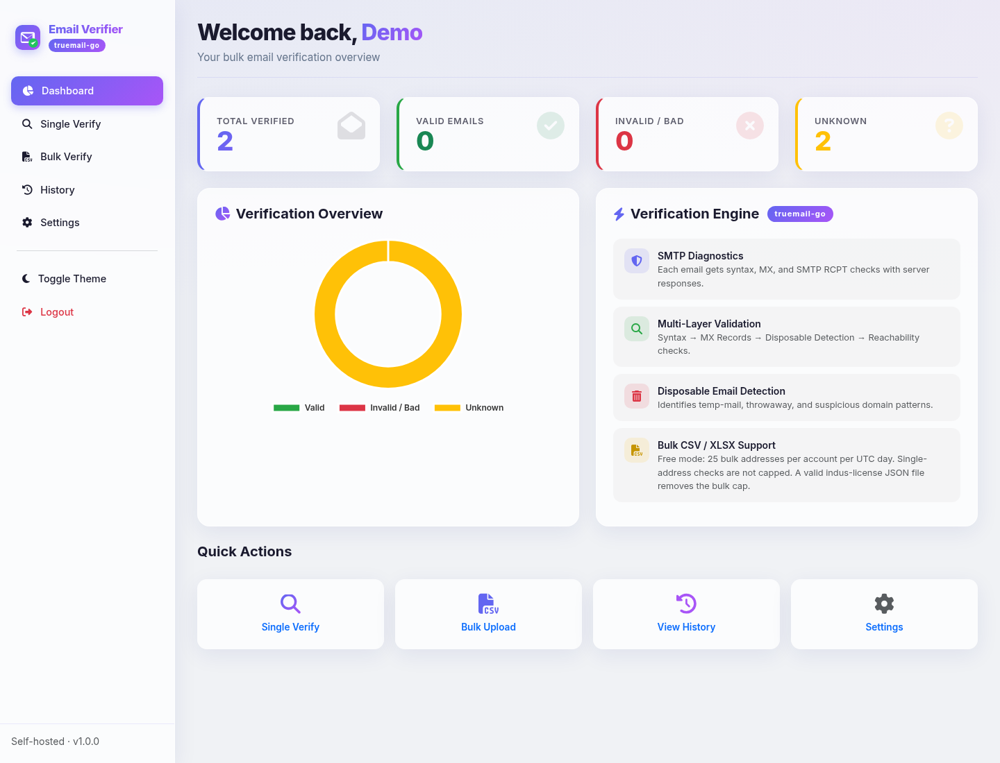

# Bulk Email Verifier

[](https://github.com/mafzalkalwardev/bulk-email-verifier/actions/workflows/ci.yml)
[](LICENSE)
[](https://nodejs.org/)
[](backend/go/go.mod)
[](docker-compose.yml)



Self-hosted email checks on your machine: syntax, MX lookup, and an SMTP mailbox dialog. Node.js UI, a Go verifier, optional Reacher in Docker.

```bash
docker compose up --build
```

Open http://localhost:5000 and register. No license file is required.

## Why this exists

Mailbox checks work by talking to the recipient's mail server. Hosted verifiers take the list and do that somewhere else. This app runs the check on a machine you control and stores accounts and history in your own database. It does not call a paid verification API.

## Free mode

With no `indus-license*.json` file, the app starts in **free mode**:

- Single-address checks are not capped.
- Bulk checks are limited to **25 addresses per account per UTC day** (`FREE_BULK_DAILY_LIMIT`).
- The bulk page states the cap. The API returns `402` when the day's allowance is gone.

A license file that verifies at `indus-web-agency.vercel.app` removes the bulk cap. An expired, rejected, or unreachable file keeps free mode and the server logs why. `INDUS_SKIP_LICENSE=1` is a local override that turns on licensed mode without a file.

SMTP still needs outbound port 25. If that port is blocked, mailbox results stay `no_smtp` and are not marked valid.

## What you can do

- Check one address and read the syntax, MX, and SMTP result.
- Upload a CSV or XLSX. The parser looks for an email in any column.
- Export every row, or only rows whose mailbox was confirmed.
- Leave a bulk job and resume it from the Bulk Verify page (stored in the browser session).
- Sign in with a local account. History stays in MongoDB, or in an in-memory database when `MONGO_URI` is empty.
- Switch the UI between light and dark.

The default engine is **truemail-go** (syntax, MX, SMTP `RCPT TO`, plus local disposable / role / free-provider lists). **Reacher** is optional:

```bash
docker compose --profile reacher up --build
```

Set `VERIFIER_ENGINE=reacher` when you want that engine. If Reacher fails, the app falls back to truemail-go. Details: [docs/ENGINES.md](docs/ENGINES.md).

## Run without Docker

Node.js 18+ and Go 1.22+.

```bash
cp .env.example .env
npm install
npm start
```

`npm start` starts the UI on port 5000 and the Go verifier on port 8080.

## Configuration

| Variable | Default | Role |
|----------|---------|------|
| `PORT` | `5000` | Web UI |
| `JWT_SECRET` | — | Set this before anyone else can reach the app |
| `MONGO_URI` | empty | Empty uses an in-memory database that resets on shutdown |
| `VERIFIER_ENGINE` | `truemail` | `truemail`, `auto` (same as truemail), or `reacher` |
| `GO_VERIFIER_URL` | `http://localhost:8080` | truemail-go |
| `REACHER_URL` | `http://localhost:8081` | Reacher, when that profile is running |
| `REACHER_TIMEOUT_MS` | `60000` | Wait before falling back to truemail-go |
| `BULK_CONCURRENCY` | `3` | Parallel addresses per batch (capped at 5) |
| `FREE_BULK_DAILY_LIMIT` | `25` | Free-mode bulk cap. Ignored in licensed mode |
| `INDUS_SKIP_LICENSE` | unset | `1` runs licensed mode with no license file |

Result fields:

| Field | Meaning |
|-------|---------|
| `domain_valid` | Syntax and MX succeeded, and the domain is not on the disposable list |
| `mailbox_verified` | `yes`, `no`, or `no_smtp` |
| `valid` | `yes` only when SMTP confirms the mailbox |

## Project layout

```
backend/go/          truemail-go HTTP service
lib/                 vendored truemail-go and AfterShip email-verifier
public/              web UI
controllers/         auth, verify, history
utils/               CSV/XLSX parser, engine client
docker-compose.yml   UI, Go verifier, MongoDB; Reacher is a profile
docs/ENGINES.md      what each engine does
```

## Contributing

See [CONTRIBUTING.md](CONTRIBUTING.md). Bug reports and feature requests use the issue templates.

## Responsible use

Use this for lists you are allowed to check. The maintainers are not responsible for misuse.

## License

MIT — [LICENSE](LICENSE). Code under `lib/` keeps its own licenses.

Author: [Muhammad Afzal Kalwar](https://github.com/mafzalkalwardev)

If this helped, a star helps others find it.
